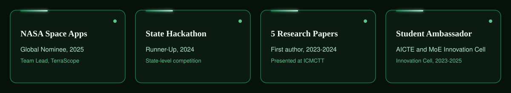

 

  

 

## About

I'm an MCA student and full-stack developer who builds web and cross-platform Flutter applications with **Python (Django, Flask)**, **React.js**, REST APIs and **MySQL**. I like projects with real users in mind: clean backend logic, solid API integrations and carefully designed databases.

- 🎓 MCA at Mar Athanasios College for Advanced Studies, Tiruvalla (2025 to present); BCA graduate, 2025
- 🚀 NASA Space Apps Challenge Global Nominee (Team Lead), 2025
- 🔭 Building with **Python Flask**, **Django**, **React** and **SQL**
- 🌱 Learning **.NET** and exploring **Laravel**
- 💬 Ask me about **Flutter**, **Flask** or **hackathons**
- ✍️ Writing technical articles on [Medium](https://medium.com/@arjunsanthosh440)
- 🎯 Looking for an entry-level Full-Stack Developer role (Flutter as a secondary focus)

## Highlights

## Journey

## Featured Projects

| Project | What it does | Built with |
| :-- | :-- | :-- |
| 🚑 [**ResQAI**](https://github.com/Arjunsanthosh09/ResQAI) Emergency response and route optimization | Predicts accident severity with a scikit-learn model to speed up ambulance dispatch. Picks hospitals by distance and traffic, runs A* routing on a road graph and reroutes on congestion. Includes a live hospital monitoring dashboard. | Python Flask, MySQL, scikit-learn, OSMnx, NetworkX |
| 🧭 [**CareerPilot AI**](https://github.com/Arjunsanthosh09/Carrer-pilot) Placement readiness platform (team of 2) | Separate student and placement-officer panels for profiles, resumes and placement drives. Uses the Gemini API for resume analysis, skill-gap analysis and mock interview feedback, plus a 0 to 100 readiness score. | Python Flask, MySQL, SQLAlchemy, Gemini API, Chart.js |
| 🛡️ [**Shieldy**](https://github.com/Arjunsanthosh09/Shieldy) Website security checker | Analyses websites for potential risks and vulnerabilities, with cookie tracking, data retrieval and risk scoring behind a cross-platform UI. | Flutter, Python Flask |
| 📜 [**Cert Gen**](https://github.com/Arjunsanthosh09/Cert-Gen-Automated-Certificate-Generation-Software) Bulk certificate generator | Creates and downloads certificates in bulk from dynamic data input, built for event-based use. | Python Flask, HTML, CSS, JavaScript |
| 🩸 [**Blood Connect**](https://github.com/Arjunsanthosh09/Blood-Connect) Blood donation management | Connects donors with recipients: donor registration, blood group and location search, and request management. | PHP, MySQL, Bootstrap, JavaScript |

## Experience

**Python Django Full Stack Intern and Team Lead** · Faith Infotech · 2026 (1-week training internship)

Led a team building **ClinicSys**, a clinic management system with a Django REST API backend and a React.js frontend. Delivered role-based dashboards for administrators, receptionists, doctors, pharmacists and lab technicians, with an analytics dashboard built in Recharts. Features include patient registration, appointment scheduling, prescriptions, pharmacy inventory with low-stock alerts, GST billing and lab reports.

## Tech Stack

| | |
| :-- | :-- |
| **Languages** |        |
| **Frameworks** |       |
| **Databases** |     |
| **AI and Data** |    |
| **Tools** |      |
| **Familiar with** |     |

## Certifications

- **Database Management System**, NPTEL (2026)
- **Career Essentials in Data Analysis**, Microsoft (2025)
- **Flutter Development**, LetsUpgrade (2024)
- **Python Training Programme**, IIT Bombay (2023)

## Contribution Heatmap

## GitHub Stats

 

